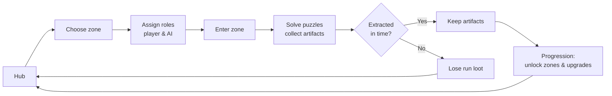
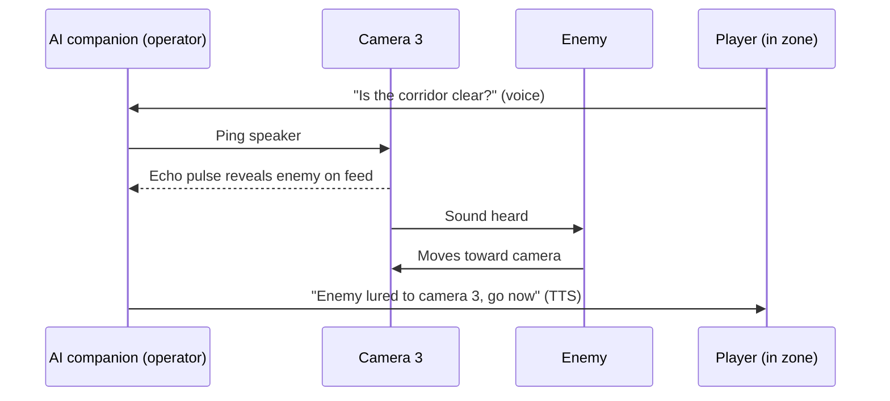
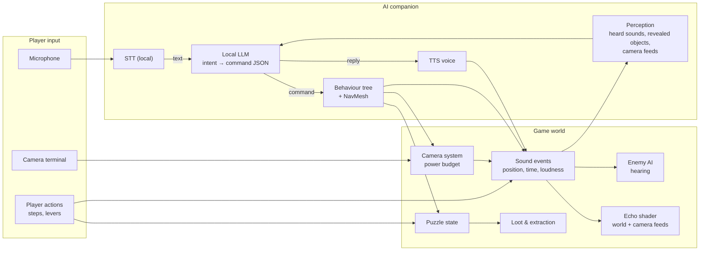

# EchoSound

A puzzle-extraction game set in total darkness, played together with an AI partner you talk to by voice. You can only see what sound reveals — but everything that hunts in the dark can hear it too.

> University project — Unity + echolocation rendering + locally hosted LLM companion + voice control. Online co-op planned for a later phase.

---

## Concept

- The world is **pitch black**. Every sound — footsteps, voices, levers, impacts — emits an **echolocation wave** that briefly reveals walls, objects and characters.
- The player ventures into zones, solves puzzles, collects artifacts and **extracts** before the dark catches them.
- **Enemies are blind but react to sound.** Making noise lets you see and solve puzzles, but draws danger to you.
- In the first phase the game is **single-player**: the player's only teammate is an **AI companion** controlled by a local LLM. The companion can take on any role a human teammate would: **operator** on the cameras, **guide** that scouts and gives directions, or **partner** that goes into the zone and presses buttons.
- The game starts with **training zones** that teach the basics. As the player progresses, harder zones unlock, with puzzles that require two agents working together.
- **Online co-op (2–3 players)** is planned for a later phase. Puzzles are designed for multiple agents from the start, so a human can later take any role the AI fills now.

## Gameplay Loop



- **Successful extraction:** collected artifacts are kept and spent on progression.
- **Failure** (caught by enemies or out of time): everything found during that run is lost.

### Progression
- **Training zones** teach echolocation, stealth, puzzle interaction and how to command the companion.
- Reaching a progression threshold unlocks **harder zones** with puzzles that require two agents.
- **Upgrades**, for example: larger echo radius, quieter footsteps, throwable noise decoys, more camera power, new companion abilities.

## Core Mechanics

### Echolocation
- Each sound emits a pulse: an expanding sphere whose edge glows as it passes over geometry, then fades.
- Louder sounds create bigger, brighter pulses — and attract enemies from further away.
- Geometry is highlighted with a world-space grid / edge effect, so simple primitives read clearly as walls and objects.

### Sound-reactive enemies
- Enemies cannot see; they navigate toward the **sounds they hear**.
- Every action has a noise level: walking, running, talking, using mechanisms, camera pings — for the player and the companion alike.
- The player must balance seeing enough to make progress against staying quiet enough to survive.

### AI companion
The companion is the player's only teammate in single-player, and the core of the project.

**Roles** — chosen before a zone or switched during it:

| Role | Where the AI is | What it does |
|---|---|---|
| **Operator** | At a camera terminal | Watches camera feeds, pings speakers to lure enemies, warns the player and tells them where to go |
| **Guide** | In the zone, ahead of the player | Scouts, describes what it hears and sees, suggests a route |
| **Partner** | In the zone, next to the player | Follows commands: press a plate, pull a lever, wait, distract an enemy |

The roles can also be swapped: the **player** sits at the terminal as operator and directs the AI through the zone.

**How it works:**
- The player speaks; speech is transcribed locally (STT).
- The LLM receives the transcript plus the **companion's current perception** and turns it into a command from a **fixed set**, for example:
  ```json
  { "action": "follow" }
  { "action": "go_to", "target": "pressure_plate_2" }
  { "action": "press", "target": "lever_east" }
  { "action": "ping_camera", "target": "camera_3" }
  { "action": "wait" }
  ```
- Commands are executed by standard game AI (NavMesh, behaviour tree), so the LLM never controls movement directly.
- The companion answers and reports with a synthesized voice (TTS): *"Enemy in the east corridor, wait."*
- **Fair perception:** the companion only knows what it can perceive — what echo pulses and camera feeds reveal and what it hears — not the full level state. This keeps it a teammate, not a cheat.
- **The companion is bound by the same rules:** its steps, actions and spoken voice in the world make noise and can attract enemies.

### Camera system
Zones contain **security cameras** viewed from terminals, similar to the camera mechanic in security-office horror games — with a twist: cameras also have **speakers**.
- **Watch:** switch between camera feeds to observe parts of the zone without being there. A feed is dark too: it only shows what echo pulses reveal.
- **Ping:** trigger a camera's speaker to emit a sound at its location. The pulse reveals the surroundings on the feed — and attracts enemies to the camera instead of the team.
- **Limits:** pings use a slowly recharging power budget, and enemies can disable a camera they reach, so cameras are a resource, not a free map.
- Cameras are used by whoever is the **operator** — the AI companion or the player.



### Puzzles for two agents
Puzzles are built around communication and sound, and work whether the second agent is the AI or (later) a human:
- **One lights, one moves:** one agent makes noise to reveal a room (and draw enemies) while the other sneaks through in the dark.
- **Asymmetric knowledge:** a code or diagram is visible only from one side or one camera, so it has to be described by voice.
- **Synchronized actions:** pressure plates or levers in different parts of the zone that must be used at the same time.
- **Decoy:** one agent lures an enemy away while the other works on a mechanism.

## Architecture (single-player)



- **Sound is a single shared event type** — `(position, time, loudness)` — used for rendering echo pulses, for enemy hearing, for camera pings and for the companion's perception.
- **The LLM never touches the scene directly.** It reads a compact text description of what the companion perceives and returns a command; the behaviour tree executes it.
- **Camera feeds** are Unity cameras rendering into a `RenderTexture` with the same echo shader.

### Echo shader (overview)
- `EchoManager` (C#) keeps a fixed-size array of active pulses and uploads them every frame via `Shader.SetGlobalVectorArray`.
- The shader computes, per pixel, the distance from its world position to each pulse origin, compares it with the pulse's current radius (`speed * (time - startTime)`), and outputs a glowing ring plus a fading trail.
- Any gameplay system emits a sound with `EchoManager.Emit(position, loudness)`.

### Later: online co-op
- A host becomes authoritative for puzzles, enemies, cameras, loot and the AI companion.
- Sound events are synced as lightweight network events; each client renders pulses locally.
- Players talk to each other over voice chat; any role the AI fills can be taken by a human.
- Players can't hurt each other — only **hit each other as a joke**: no damage, but a loud noise enemies can hear.

## Tech Stack (planned)

| Area | Choice |
|---|---|
| Engine | Unity (URP, Shader Graph) |
| LLM | Local model (7–8B class) via Ollama or llama.cpp server |
| Speech-to-text | faster-whisper / whisper.cpp |
| Text-to-speech | Piper |
| Enemy & companion AI | NavMesh + behaviour tree / finite state machine |
| Networking *(later)* | Netcode for GameObjects or FishNet *(TBD)* |
| Voice chat *(later)* | Vivox or Dissonance *(TBD)* |

## Roadmap

**Phase 1 — single-player with AI companion**
- [ ] Prototype: one dark room, echolocation shader + `EchoManager`
- [ ] Sound-reactive enemy (hearing + chase)
- [ ] Companion basics: follow / go to / press, executed by behaviour tree
- [ ] Voice commands: STT → LLM → command JSON
- [ ] Companion perception and TTS replies
- [ ] Camera system: terminals, feeds via `RenderTexture`, speaker pings, power budget
- [ ] Companion roles: partner, guide, operator (and player-as-operator)
- [ ] Training zone with 2–3 basic puzzles
- [ ] Extraction loop: artifacts, extraction point, losing loot on failure
- [ ] Harder zones with two-agent puzzles
- [ ] Progression: hub, zone unlocks, upgrades

**Phase 2 — online co-op**
- [ ] Host-authoritative networking for 2–3 players
- [ ] Synced sound events, puzzle state, enemies and cameras
- [ ] Voice chat between players
- [ ] Playful non-damaging hits that emit noise

## Requirements

- Unity 6000.3
- A GPU capable of running a 7–8B LLM locally
- Microphone; headphones recommended

## Getting Started

### Room generation playground

Use **Unity 6000.6.7f1**. Open `Assets/EchoSound/Scenes/RoomShowcase.unity` to see 14 editable room prefabs, including bridges and pit walkways, secret alcoves, two-player puzzle layouts, ambush corners and a pillar room. Encounter markers describe future gameplay placements; puzzles and enemies are not implemented.

Open `Assets/EchoSound/Scenes/GenerationTest.unity` to generate layouts in the Inspector or press Play to walk through them. The scene contains only room generation, scene lighting and a first-person player: no flashlight, artifacts, extraction, HUD or minimap.

Select **Level Generator → Generate Preview / Same Seed** or **Generate Next Seed**. Add new **GameObject prefab assets** to `Assets/EchoSound/Settings/DefaultRooms.asset`; no generator changes are needed for compatible room variants.

**[Room authoring guide](ROOM_AUTHORING.md)** · **[Script reading guide](Assets/EchoSound/Scripts/README.md)**

Controls: WASD + mouse, Shift to run, Space to jump, Esc to release the cursor, R to regenerate, T to respawn. Falling into a pit returns the player to the starting room.

Separate modules handle room metadata/catalog, layout data and prefab placement, player controls, and test-scene wiring. All C# comments are in English. Editor checks cover 1000 layouts and physical routes from each room's safe anchor to its doorways.

### AI companion playground

1. Install [Ollama](https://ollama.com), run `ollama serve` and pull a model that supports tools, e.g. `ollama pull qwen3.5:9b`. The model name is set on the companion's `CompanionBrain` component.
2. Select **EchoSound → Create companion test scene** once. This creates `Assets/EchoSound/Prefabs/Companion/AICompanion.prefab` and `Assets/EchoSound/Scenes/CompanionTest.unity`.
3. Press Play. Press Enter to type an order to the companion, for example *"открой дверь передо мной"*, *"follow me"* or *"stop"*. Press E to use a door yourself.

The LLM picks functions from a fixed set (`follow_curator`, `wait_here`, `go_to`, `open_door`, `close_door`). The companion walks there through the NavMesh first, then uses the object and reports back. Text chat stands in for speech-to-text for now.

## Team

- Anton Liubetskyi
- Mykhailo Kostenko
- Leonid Krichevskyi
- Mykyta Luchaninov
