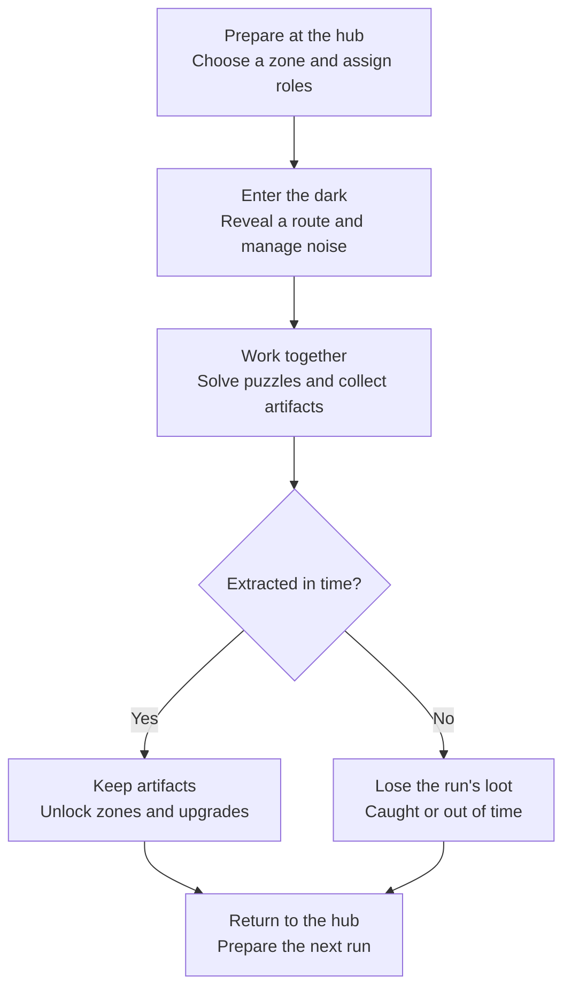
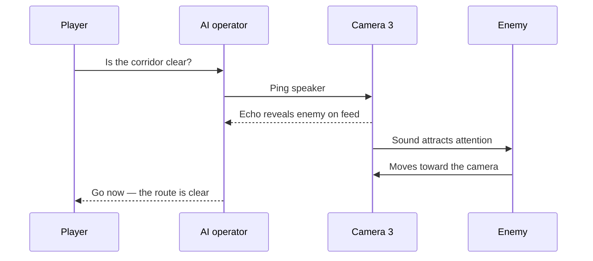
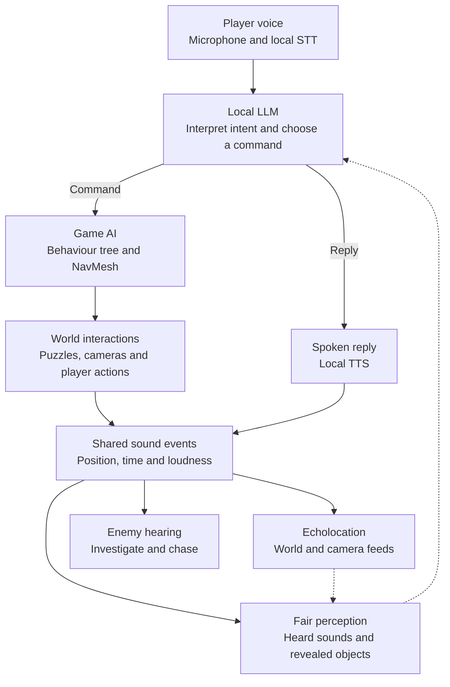

# EchoSound

A puzzle-extraction game in total darkness, with an AI teammate you talk to by voice.
Every sound reveals the world. Every sound can bring something closer.

**University project** · Echolocation · Voice-driven AI · Unity

[The game](#the-game) · [Your companion](#one-companion-three-roles) · [Architecture](#architecture) · [Roadmap](#roadmap) · [Development setup](#getting-started)

## The game

You are in a room you cannot see. A footstep sends a wave across the floor: walls, a doorway, something moving at the edge of the echo. Then darkness returns. Your teammate asks whether to move. Answering will make noise too.

**EchoSound is built around one dilemma: the sound that helps you survive also gives you away.** There is no permanent view of the level. Footsteps, voices, levers and impacts briefly reveal the world through echolocation, while blind enemies follow what they hear.

Venture into dangerous zones, solve puzzles together, recover artifacts and find a way out. You decide when to stay quiet, when to reveal your surroundings and when to let your partner draw attention. Escape with your finds to unlock harder zones and new tools; get caught or run out of time and lose everything collected during that run.

Your first teammate is a **local AI companion you speak to by voice**. It can explore beside you, scout ahead or guide you from a camera terminal. Later, online co-op for **2–3 players** will let humans take those roles.

> EchoSound is in early development. The sections below describe the intended game; the current prototype and setup are documented [at the end](#getting-started).

### The extraction loop



### Core mechanics

| System | How it plays | The tradeoff |
| :--- | :--- | :--- |
| **Echolocation** | Waves briefly reveal walls, objects and characters before fading into darkness | More visibility means more noise |
| **Enemy hearing** | Blind enemies investigate footsteps, speech, mechanisms and camera pings | Every agent's actions can expose the team |
| **AI teammate** | Talk to your partner to coordinate movement, mechanisms and distractions | The companion only knows what it can perceive |
| **Camera terminals** | Dark camera feeds reveal only what echoes illuminate; speakers create remote pulses | Pings consume recharging power, and enemies can disable cameras |

### One companion, three roles

“Wait here.” “Pull that lever.” “Is the corridor clear?” Cooperation happens through conversation. The companion responds aloud and acts on your instructions, but only knows what it can hear or what echoes and camera feeds reveal. You have to share information and work together.

| Role | Position | Responsibility |
| :--- | :--- | :--- |
| **Operator** | At a camera terminal | Watch feeds, ping speakers, warn the player and give directions |
| **Guide** | Ahead of the player | Scout, describe what it perceives and suggest a route |
| **Partner** | Alongside the player | Follow, wait, press plates, pull levers and distract enemies |

Roles can change before or during a zone. The **player can also act as operator**, directing the companion through the level. The companion follows the same sound rules as the player: its footsteps, actions and spoken replies can attract enemies.

### Cameras as a shared tool

An operator can use a camera's speaker to reveal a corridor and lure an enemy away from the team. Power limits and destructible cameras make each ping a decision.



### Puzzles built for two

Puzzles depend on communication, timing and sound. The second agent can be your AI companion or, later, another player.

- **One lights, one moves.** One agent reveals the room and draws attention while the other crosses it.
- **Asymmetric knowledge.** A code or diagram is visible from only one position or camera and must be described to the other agent.
- **Synchronized actions.** Agents activate distant plates or levers together.
- **Decoy.** One agent lures an enemy away while the other works on a mechanism.

### Progression

Training zones introduce echolocation, stealth, puzzle interaction and companion commands. Progression unlocks harder zones and upgrades such as a larger echo radius, quieter footsteps, noise decoys, more camera power and new companion abilities.

## Architecture

The planned single-player architecture separates voice interpretation, action execution and world feedback. **The LLM chooses from a fixed command set; it never controls movement or edits the scene directly.**



| Boundary | Contract |
| :--- | :--- |
| **Voice → intent** | Local STT supplies the transcript; the LLM also receives a compact description of the companion's perception |
| **Intent → action** | A behaviour tree / NavMesh executes a command from the fixed set |
| **Intent → speech** | TTS voices replies and reports, such as “Enemy in the east corridor, wait” |
| **World → perception** | Only heard sounds, echo-revealed objects and accessible camera feeds are exposed to the companion |
| **Sound → systems** | A shared event `(position, time, loudness)` drives echo rendering, enemy hearing and companion perception |

<details>
<summary><strong>Example command payloads</strong></summary>

Each object below is a separate example response:

```json
[
  { "action": "follow" },
  { "action": "go_to", "target": "pressure_plate_2" },
  { "action": "press", "target": "lever_east" },
  { "action": "ping_camera", "target": "camera_3" },
  { "action": "wait" }
]
```

</details>

<details>
<summary><strong>Planned echo rendering</strong></summary>

- `EchoManager` keeps a fixed-size array of active pulses and uploads it every frame through `Shader.SetGlobalVectorArray`.
- The shader compares each pixel's world-space distance from a pulse origin with `speed * (time - startTime)`, producing a glowing ring and fading trail.
- Gameplay systems emit sounds through the proposed `EchoManager.Emit(position, loudness)` API.
- Security cameras render into a `RenderTexture` using the same echo effect as the player's view.

</details>

<details>
<summary><strong>Later: online co-op</strong></summary>

- The host is authoritative for puzzles, enemies, cameras, loot and the AI companion.
- Lightweight sound events are synchronized; each client renders pulses locally.
- Voice chat lets humans take any role the companion fills in single-player.
- Playful hits deal no player damage but emit noise that enemies can hear.

</details>

### Technology choices

| Area | Choice | Status |
| :--- | :--- | :--- |
| Engine | Unity **6000.6.7f1**, C# | Current |
| Rendering | URP / Shader Graph echolocation | Planned |
| Language model | Bundled Qwen3 1.7B Q4_K_M + llama.cpp, CPU | Current (companion test scene) |
| Speech recognition | Bundled whisper.cpp + multilingual Whisper base Q5_1 + Silero VAD, CPU | Current (companion test scene) |
| Speech synthesis | Piper | Planned |
| Agent navigation | NavMesh + behaviour tree / finite state machine | Planned |
| Networking | Netcode for GameObjects or FishNet | Later · undecided |
| Voice chat | Vivox or Dissonance | Later · undecided |

The current playground needs the Unity editor above. The planned voice companion will also need a microphone and hardware capable of hosting the chosen model locally; its hardware requirements are not yet validated. Headphones are recommended for voice play.

## Roadmap

### Phase 1 · single-player with an AI companion

- [ ] Dark-room prototype: echolocation shader and `EchoManager`
- [ ] Sound-reactive enemy: hearing and chase
- [ ] Companion actions: follow, go to, press
- [ ] Voice pipeline: STT → LLM → command JSON
- [ ] Fair companion perception and TTS replies
- [ ] Camera terminals, feeds, speaker pings and power budget
- [ ] Partner, guide and operator roles, including player-as-operator
- [ ] Training zone with 2–3 basic puzzles
- [ ] Artifacts, extraction point and loss of run loot on failure
- [ ] Harder zones with two-agent puzzles
- [ ] Hub, zone unlocks and upgrades

### Phase 2 · online co-op

- [ ] Host-authoritative networking for 2–3 players
- [ ] Synced sounds, puzzles, enemies and cameras
- [ ] Voice chat between players
- [ ] Non-damaging player hits that emit noise

## Getting started

The current prototype is a **room-generation playground** with 14 editable room prefabs, seeded layouts, a first-person controller and editor checks. Echolocation, enemies, the voice companion and extraction are still planned.

1. Add this repository as a project in **Unity Hub** and open it with **Unity 6000.6.7f1**, the version recorded in [ProjectVersion.txt](ProjectSettings/ProjectVersion.txt).
2. Open **EchoSound → Open generation test**, or open [GenerationTest.unity](Assets/EchoSound/Scenes/GenerationTest.unity) directly.
3. Press **Play** to explore a generated layout.

To preview layouts outside Play mode, select **Level Generator** and use **Generate Preview / Same Seed** or **Generate Next Seed** in the Inspector.

### Controls

| Input | Action | Input | Action |
| :--- | :--- | :--- | :--- |
| `W` `A` `S` `D` | Move | Mouse | Look |
| `Shift` | Run | `Space` | Jump |
| `R` | Generate next layout with cursor captured | `T` | Respawn at the starting room |
| `Esc` | Release cursor | Fall into a pit | Automatically return to the start |

### Explore and author rooms

Open **EchoSound → Open room showcase**, or [RoomShowcase.unity](Assets/EchoSound/Scenes/RoomShowcase.unity), to inspect all 14 room prefabs: bridges, pit walkways, secret alcoves, two-agent puzzle layouts, ambush corners and a pillar room. Encounter markers describe future placements; they do not implement puzzles or enemies.

Edit geometry in [room prefabs](Assets/EchoSound/Prefabs/Rooms) and add compatible **GameObject prefab assets** to [DefaultRooms.asset](Assets/EchoSound/Settings/DefaultRooms.asset). Compatible variants require no generator changes. For code navigation, start with the [script reading guide](Assets/EchoSound/Scripts/README.md).

The generation scene contains room generation, scene lighting and a first-person player. Flashlight, artifacts, extraction, HUD and minimap are not included.

### Editor checks

Run these from the Unity menu:

| Menu item | What it checks |
| :--- | :--- |
| **EchoSound → Checks → Validate 1000 layouts** | Connectivity, deterministic generation, matching doorways and prefab rotation |
| **EchoSound → Checks → Validate prefab walkways** | Physical routes from each room's safe anchor to its doorways, including pit walkways |

### AI companion playground

**Players:** download/extract the complete Windows build folder and run `EchoSound.exe`.
The build includes the language model, speech model and native engines. No Ollama,
Python, model download, account, internet connection or dedicated GPU is required
at runtime. Keep `EchoSound_Data` beside the executable. Wait for the companion to
finish preparing, hold **V** to speak, or press **Enter** to type. **Esc** releases
the mouse and exposes Follow / Stop / Come here buttons in the chat.

**Developers / build machines:** prepare the redistributable files once:

```powershell
# Build machine only: hf CLI and Visual Studio C++ build tools/Redist files.
./Tools/Prepare-LocalAI.ps1
```

The script downloads pinned CPU binaries and model revisions, verifies archive
and model checksums, and includes upstream licenses. It copies app-local Visual
C++ runtime DLLs from the build machine's Visual Studio Redist directory; players
do not run a Visual C++ installer. Files live in `Runtime/AI`
(ignored by Git), outside Unity's asset importer. Re-run the script on a fresh
checkout or CI machine. To check a prepared bundle without network access:

```powershell
./Tools/Prepare-LocalAI.ps1 -VerifyOnly
```

1. In Unity, select **EchoSound → Create companion test scene**, then press Play.
   Existing companion components also start the bundled engines automatically.
2. For a distributable build, select **EchoSound → Build → Windows offline companion**.
   Output: `Builds/Windows/EchoSound.exe`. This builds the companion playground;
   it does not turn the rest of the planned game into a finished release.
3. Distribute the **whole** `Builds/Windows` folder. Build hooks verify and copy the
   AI bundle into `EchoSound_Data/StreamingAssets/AI`, including its licenses.
   Missing/corrupt bundles fail the build instead of creating an unusable release.

The baseline uses CPU inference with at most four threads per engine and a 4096-token
context. The command interpreter allows 12 output tokens. Conversation uses a
separate compact prompt and streams plain text: Fast LLM allows 48 output tokens
and one sentence; Free dialogue allows 80 tokens and two sentences. Complete
sentences are retained when a reply reaches its deadline; unfinished fragments
are not presented as complete replies.
It does not reserve dedicated VRAM for AI.
RAM use, response latency and gameplay FPS still depend on hardware; minimum
requirements have not been established by testing low-end computers. Windows x64
is the currently packaged platform; other platforms require their own native bundles.

Game code checks for an explicit order before it sends anything to the gameplay planner.
The bundled Qwen3 1.7B can propose up to two actions, and each one must match its clause.
Conversation goes through a reply-only request in both LLM modes. It preserves ongoing
actions, retains up to four recent exchanges within a bounded window and tracks explicit player
names and cat names separately from generated text. Game code resolves
each door's direction from its own clause and uses current perception to select a target.
Explicit sequences such as “open the door on the left, then close the door on the right”
must have a valid action for each step before any action starts. The planner has a
1.5-second inference deadline; fast chat has a 1.9-second deadline and Free dialogue
has a 3.5-second deadline. Speech recognition,
startup, walking and door animation take additional time.

Press **Esc** to choose **Quick commands**, **Fast LLM**, or **Free dialogue (slower)**.
Quick commands uses only exact shortcuts and does not load the language model.
Fast LLM accepts paraphrased commands with explicit action words. Quoted or reported
orders never reach the planner. Unsupported or ambiguous orders may require rephrasing.
Free dialogue uses the same command rules and allows two short sentences. Questions
about nearby objects receive a compact sample of current observations. Switching to Quick commands cancels
inference and unloads the language model. Speech recognition stays available in all modes.
Direct shortcuts remain available while Fast LLM is preparing.
Common teammate conversation (mood, reassurance, jokes and their explanations) uses
authored replies in all modes. Follow-up reasons track the last topic or command;
asking for another joke selects a different line. This is distinct from model-generated
conversation, which remains less reliable on unfamiliar topics. Actual generated text
appears progressively in the chat; a new input clears the previous unfinished reply.
Player and cat names can be introduced together and corrected independently.
Door status questions such as “Is the door on my left open?” read the current door state
and reply without interrupting an ongoing action. They are available in all modes.
“Follow me and open all the doors” starts escort. The companion opens closed doors
between it and the player or directly in front of the nearby player, then resumes
following. “Stop” cancels escort. “Open all the doors” opens reachable doors within
the companion's initial perception and reports if some were out of reach. Both
commands use the same door interactions as the player and work in all modes.

Exact standalone follow / stop / come-here phrases in English,
Polish and Russian bypass generation. A recognised movement suffix after an explicit
door order (such as "open the door and then follow me") is executed separately.
Simple open/close door commands also bypass generation, including front/behind/left/right
relative to the player. For an unspecified door, a perceived door under the player's
crosshair takes priority; otherwise choose a door in front needing the requested change.
Similarly close candidates trigger a clarification. An explicitly aimed door that is
already open/closed is acknowledged without choosing another target. Door actions still
use the shared navigation and interaction rules. Timing to begin an action excludes the
time needed to walk to the door and animate its panel.
An explicit Russian request to wait here while the player looks around also bypasses
generation; an explanation containing a second order is not accepted by this shortcut.
Questions, conditions and unrecognised suffixes are left intact for interpretation.
Each model request produces one bounded plan; execution results cannot start another
model-driven action loop. This is a small model: unfamiliar wording can still
produce the wrong intent. No fine-tuning has been performed.

Speech defaults to the system language (Russian/Polish/English). Press **Esc** and
choose **Russian / Polish / English / Auto** in the chat to change it; the choice
is saved. A fixed language avoids re-detecting the language of each short command.
Recognition uses one greedy pass without temperature retries or word timestamps.
Auto remains available for mixed-language speech, without a second recognition
pass. Existing single-language inspector settings are preserved. Replies currently
appear as text; TTS remains planned.
PTT phrases use a duration-bounded Whisper audio context with at least ten seconds
of encoder context, a small vocabulary hint and synthetic boundary padding.
Padding adds samples without waiting for extra recording time. Silence and DC recordings are
discarded before recognition. Microphone capture drains complete remaining frames
on a normal PTT release. Uncertain transcripts can still need correction, especially names.
If speech recognition fails, text input remains available. If inference fails,
the basic movement shortcuts remain available. Engine errors are recorded in the
Unity/player log; the chat does not ask players to install developer tools.

### Offline AI checks

The [dialogue update report](Tests/Reports/2026-11-17-dialogue-v2/README.md) separates
authored conversation, generated answers, actual streamed first text and complete replies.

The [2026-11-17 acceptance report](Tests/Reports/2026-11-17/README.md) includes raw
results, latency misses and dialogue quality findings. The one-second target is
not yet met for every input.

The built-player acceptance suite measures time from submitting a complete PCM buffer
or typed order to the first complete reply or the start of an action. Navigation and
door animation completion are checked separately. It records every one-second miss.

```powershell
./Tools/Prepare-CompanionTests.ps1
python Tools/Test-Companion.py --prepare
python Tools/Test-Companion.py --build Builds/Windows
python Tools/Test-Companion.py --folder .utmp/companion-render-tests --prepare-render-from .utmp/companion-tests
python Tools/Test-Companion.py --folder .utmp/companion-render-tests --build Builds/Windows --render
```

Synthetic voices use installed Windows voices. Missing languages are listed in
`.utmp/companion-tests/coverage.json`. The suite covers clean, quieter, noisy and padded
recordings, two Russian voices when available, English speech, text in three languages,
door sequences, escort, memory corrections, negation, quoted speech, silence, tones,
cancellation and disabling voice input. Results and all failures are retained in JSON
and Markdown beside the fixtures. Exit code 1 means functional failures and 2 means
the one-second target was missed. Use `--render` to retain the graphics device.
The suite confirms state assertions and a reply, with generated dialogue retained for
manual quality review. It does not establish real-microphone accuracy or low-end requirements.

- **EchoSound → Checks → Validate local AI commands** checks shortcut boundaries,
  rejected/unknown targets, structured output, voice encoding and bundle integrity.
  It exports the actual client's test requests to `.utmp/ai-fixtures.json`.
- `python Tools/Test-LocalAI.py` starts the bundled CPU servers, checks multilingual
  actions, questions, negation, multi-step orders and silence, then closes its servers.
  Optional `--audio path/to/jfk.wav` checks the public whisper.cpp JFK speech sample.
  Reports/logs go to `.utmp`; this is a developer test, not a player prerequisite.
- `python Tools/Test-FastLLM.py` checks the actual exported Fast LLM requests, conservative
  guards and target-direction resolution on Russian/English/Polish cases, including
  held-out paraphrases. It reports warm inference latency separately from the cold prompt.
  LocalAiChecks exports `.utmp/fast-llm-fixtures.json`; pass `--fixtures` to use another path.
- `./Tools/Test-OfflineBuild.ps1` launches the built game headlessly, checks actual
  navigation, conversation, actions and speech, then verifies the missing-model
  fallback and process cleanup. It verifies direct door actions, immediate clarification,
  and that Quick commands does not load the language model, before testing optional dialogue.
  It temporarily renames the built LLM weights and
  restores them in a `finally` block. Do not run it while playing that same build.
- Optional `-VoiceFixtures path/to/folder` also sends `follow.wav`, `stop.wav`,
  `follow2.wav`, `door.wav` and `fast-door.wav` through the actual game voice component.
  The last file must say a non-shortcut phrase such as “Распахни дверь впереди” and must
  execute through Fast LLM. Fixtures must be mono PCM16 WAVs with Russian commands. The player log
  records recognition, release-to-command and model latency separately.
- `python Tools/Benchmark-Voice.py path/to/folder --language russian` compares the
  previous auto-language pipeline with the current single-pass pipeline on the same
  local WAV files. It never captures a microphone. Synthetic fixtures measure latency
  and regressions; they do not establish accuracy for real microphones or accents.

## Team

Anton Liubetskyi · Mykhailo Kostenko · Leonid Krichevskyi · Mykyta Luchaninov

Licensed under [MIT](LICENSE).
