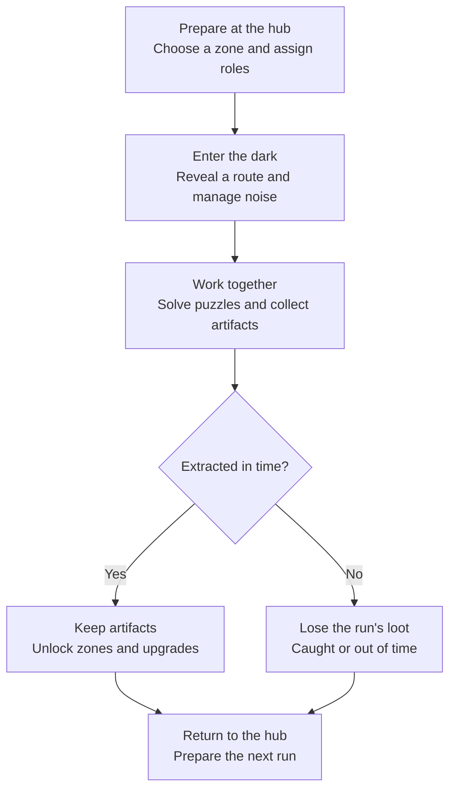
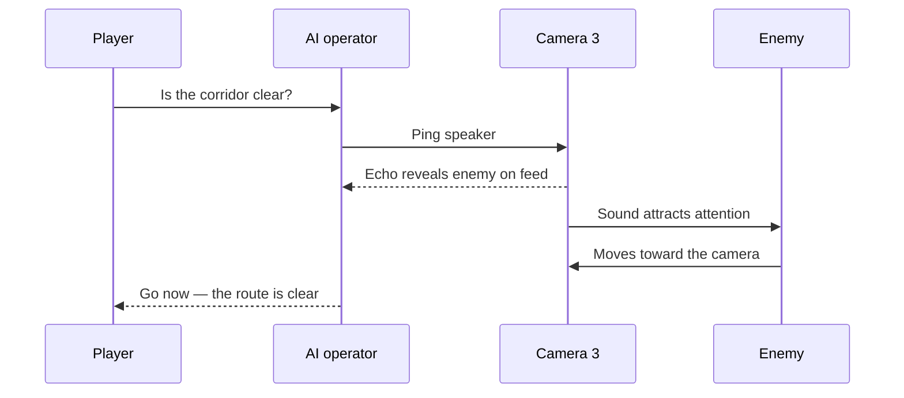
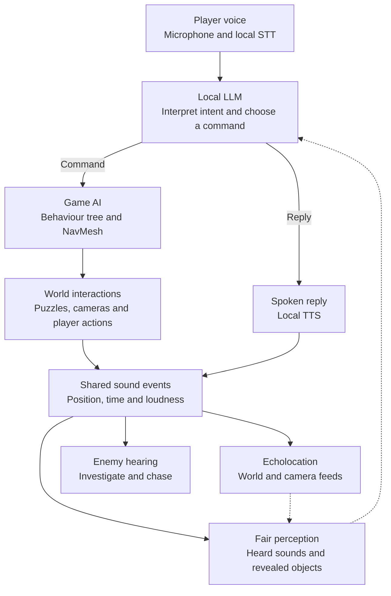

# EchoSound

A puzzle-extraction game in total darkness, with an AI teammate you talk to by voice.
Every sound reveals the world. Every sound can bring something closer.

**University project** · Echolocation · Voice-driven AI · Unity

[The game](#the-game) · [Your companion](#one-companion-three-roles) · [Architecture](#architecture) · [Roadmap](#roadmap) · [Development setup](#getting-started)

## The game

You are in a room you cannot see. A footstep sends a wave across the floor: walls, a doorway, something moving at the edge of the echo. Then darkness returns. Your teammate asks whether to move. Answering will make noise too.

**EchoSound is built around one dilemma: the sound that helps you survive also gives you away.** There is no permanent view of the level. Footsteps, voices, levers and impacts briefly reveal the world through echolocation, while blind enemies follow what they hear.

Venture into dangerous zones, solve puzzles together, recover artifacts and find a way out. You decide when to stay quiet, when to reveal your surroundings and when to let your partner draw attention. Escape with your finds to unlock harder zones and new tools; get caught or run out of time and lose everything collected during that run.

Your first teammate is a **local AI companion you speak to by voice**. It can explore beside you, scout ahead or guide you from a camera terminal. Later, online co-op for **2–3 players** will let humans take those roles.

> EchoSound is in early development. The sections below describe the intended game; the current prototype and setup are documented [at the end](#getting-started).

### The extraction loop



### Core mechanics

| System | How it plays | The tradeoff |
| :--- | :--- | :--- |
| **Echolocation** | Waves briefly reveal walls, objects and characters before fading into darkness | More visibility means more noise |
| **Enemy hearing** | Blind enemies investigate footsteps, speech, mechanisms and camera pings | Every agent's actions can expose the team |
| **AI teammate** | Talk to your partner to coordinate movement, mechanisms and distractions | The companion only knows what it can perceive |
| **Camera terminals** | Dark camera feeds reveal only what echoes illuminate; speakers create remote pulses | Pings consume recharging power, and enemies can disable cameras |

### One companion, three roles

“Wait here.” “Pull that lever.” “Is the corridor clear?” Cooperation happens through conversation. The companion responds aloud and acts on your instructions, but only knows what it can hear or what echoes and camera feeds reveal. You have to share information and work together.

| Role | Position | Responsibility |
| :--- | :--- | :--- |
| **Operator** | At a camera terminal | Watch feeds, ping speakers, warn the player and give directions |
| **Guide** | Ahead of the player | Scout, describe what it perceives and suggest a route |
| **Partner** | Alongside the player | Follow, wait, press plates, pull levers and distract enemies |

Roles can change before or during a zone. The **player can also act as operator**, directing the companion through the level. The companion follows the same sound rules as the player: its footsteps, actions and spoken replies can attract enemies.

### Cameras as a shared tool

An operator can use a camera's speaker to reveal a corridor and lure an enemy away from the team. Power limits and destructible cameras make each ping a decision.



### Puzzles built for two

Puzzles depend on communication, timing and sound. The second agent can be your AI companion or, later, another player.

- **One lights, one moves.** One agent reveals the room and draws attention while the other crosses it.
- **Asymmetric knowledge.** A code or diagram is visible from only one position or camera and must be described to the other agent.
- **Synchronized actions.** Agents activate distant plates or levers together.
- **Decoy.** One agent lures an enemy away while the other works on a mechanism.

### Progression

Training zones introduce echolocation, stealth, puzzle interaction and companion commands. Progression unlocks harder zones and upgrades such as a larger echo radius, quieter footsteps, noise decoys, more camera power and new companion abilities.

## Architecture

The planned single-player architecture separates voice interpretation, action execution and world feedback. **The LLM chooses from a fixed command set; it never controls movement or edits the scene directly.**



| Boundary | Contract |
| :--- | :--- |
| **Voice → intent** | Local STT supplies the transcript; the LLM also receives a compact description of the companion's perception |
| **Intent → action** | A behaviour tree / NavMesh executes a command from the fixed set |
| **Intent → speech** | TTS voices replies and reports, such as “Enemy in the east corridor, wait” |
| **World → perception** | Only heard sounds, echo-revealed objects and accessible camera feeds are exposed to the companion |
| **Sound → systems** | A shared event `(position, time, loudness)` drives echo rendering, enemy hearing and companion perception |

<details>
<summary><strong>Example command payloads</strong></summary>

Each object below is a separate example response:

```json
[
  { "action": "follow" },
  { "action": "go_to", "target": "pressure_plate_2" },
  { "action": "press", "target": "lever_east" },
  { "action": "ping_camera", "target": "camera_3" },
  { "action": "wait" }
]
```

</details>

<details>
<summary><strong>Planned echo rendering</strong></summary>

- `EchoManager` keeps a fixed-size array of active pulses and uploads it every frame through `Shader.SetGlobalVectorArray`.
- The shader compares each pixel's world-space distance from a pulse origin with `speed * (time - startTime)`, producing a glowing ring and fading trail.
- Gameplay systems emit sounds through the proposed `EchoManager.Emit(position, loudness)` API.
- Security cameras render into a `RenderTexture` using the same echo effect as the player's view.

</details>

<details>
<summary><strong>Later: online co-op</strong></summary>

- The host is authoritative for puzzles, enemies, cameras, loot and the AI companion.
- Lightweight sound events are synchronized; each client renders pulses locally.
- Voice chat lets humans take any role the companion fills in single-player.
- Playful hits deal no player damage but emit noise that enemies can hear.

</details>

### Technology choices

| Area | Choice | Status |
| :--- | :--- | :--- |
| Engine | Unity **6000.6.7f1**, C# | Current |
| Rendering | URP / Shader Graph echolocation | Planned |
| Language model | Local 7–8B model via Ollama or llama.cpp server | Planned |
| Speech recognition | faster-whisper or whisper.cpp | Planned |
| Speech synthesis | Piper | Planned |
| Agent navigation | NavMesh + behaviour tree / finite state machine | Planned |
| Networking | Netcode for GameObjects or FishNet | Later · undecided |
| Voice chat | Vivox or Dissonance | Later · undecided |

The current playground needs the Unity editor above. The planned voice companion will also need a microphone and hardware capable of hosting the chosen model locally; its hardware requirements are not yet validated. Headphones are recommended for voice play.

## Roadmap

### Phase 1 · single-player with an AI companion

- [ ] Dark-room prototype: echolocation shader and `EchoManager`
- [ ] Sound-reactive enemy: hearing and chase
- [ ] Companion actions: follow, go to, press
- [ ] Voice pipeline: STT → LLM → command JSON
- [ ] Fair companion perception and TTS replies
- [ ] Camera terminals, feeds, speaker pings and power budget
- [ ] Partner, guide and operator roles, including player-as-operator
- [ ] Training zone with 2–3 basic puzzles
- [ ] Artifacts, extraction point and loss of run loot on failure
- [ ] Harder zones with two-agent puzzles
- [ ] Hub, zone unlocks and upgrades

### Phase 2 · online co-op

- [ ] Host-authoritative networking for 2–3 players
- [ ] Synced sounds, puzzles, enemies and cameras
- [ ] Voice chat between players
- [ ] Non-damaging player hits that emit noise

## Getting started

The current prototype is a **room-generation playground** with 14 editable room prefabs, seeded layouts, a first-person controller and editor checks. Echolocation, enemies, the voice companion and extraction are still planned.

1. Add this repository as a project in **Unity Hub** and open it with **Unity 6000.6.7f1**, the version recorded in [ProjectVersion.txt](ProjectSettings/ProjectVersion.txt).
2. Open **EchoSound → Open generation test**, or open [GenerationTest.unity](Assets/EchoSound/Scenes/GenerationTest.unity) directly.
3. Press **Play** to explore a generated layout.

To preview layouts outside Play mode, select **Level Generator** and use **Generate Preview / Same Seed** or **Generate Next Seed** in the Inspector.

### Controls

| Input | Action | Input | Action |
| :--- | :--- | :--- | :--- |
| `W` `A` `S` `D` | Move | Mouse | Look |
| `Shift` | Run | `Space` | Jump |
| `R` | Generate next layout with cursor captured | `T` | Respawn at the starting room |
| `Esc` | Release cursor | Fall into a pit | Automatically return to the start |

### Explore and author rooms

Open **EchoSound → Open room showcase**, or [RoomShowcase.unity](Assets/EchoSound/Scenes/RoomShowcase.unity), to inspect all 14 room prefabs: bridges, pit walkways, secret alcoves, two-agent puzzle layouts, ambush corners and a pillar room. Encounter markers describe future placements; they do not implement puzzles or enemies.

Edit geometry in [room prefabs](Assets/EchoSound/Prefabs/Rooms) and add compatible **GameObject prefab assets** to [DefaultRooms.asset](Assets/EchoSound/Settings/DefaultRooms.asset). Compatible variants require no generator changes. For code navigation, start with the [script reading guide](Assets/EchoSound/Scripts/README.md).

The generation scene contains room generation, scene lighting and a first-person player. Flashlight, artifacts, extraction, HUD and minimap are not included.

### Editor checks

Run these from the Unity menu:

| Menu item | What it checks |
| :--- | :--- |
| **EchoSound → Checks → Validate 1000 layouts** | Connectivity, deterministic generation, matching doorways and prefab rotation |
| **EchoSound → Checks → Validate prefab walkways** | Physical routes from each room's safe anchor to its doorways, including pit walkways |

## Team

Anton Liubetskyi · Mykhailo Kostenko · Leonid Krichevskyi · Mykyta Luchaninov

Licensed under [MIT](LICENSE).
